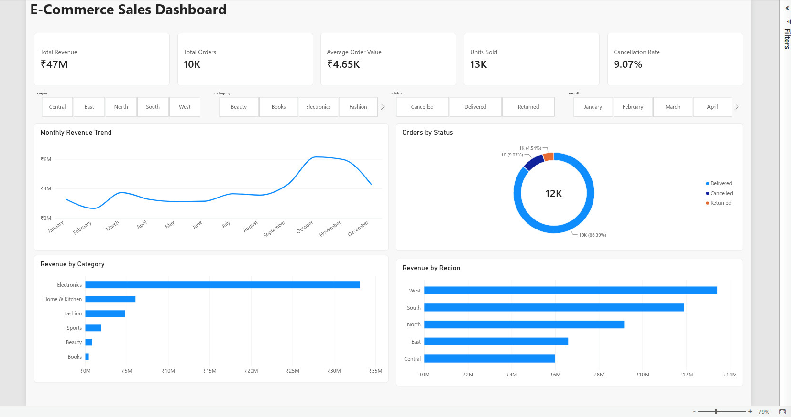
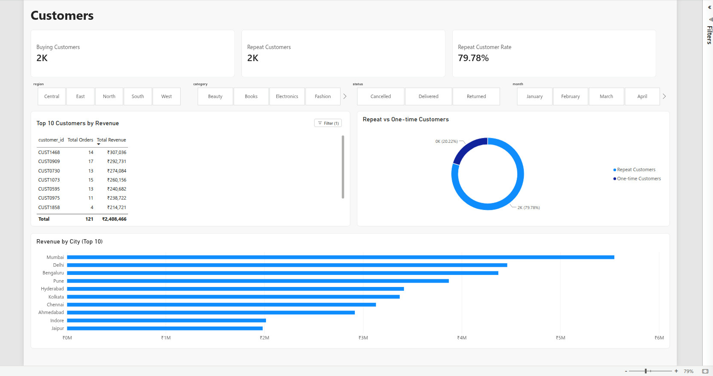
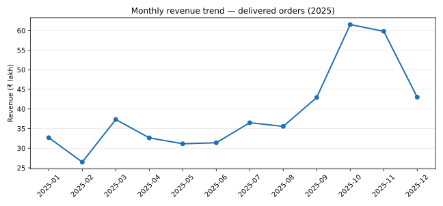
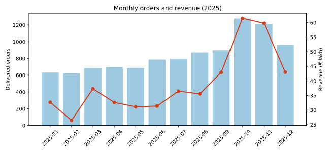
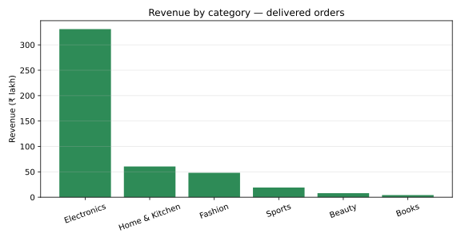
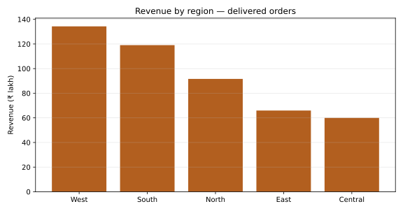
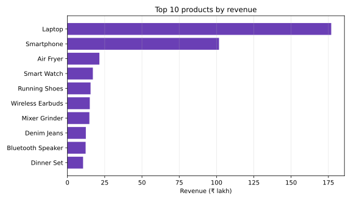

# E-Commerce Sales Analysis — India

An end-to-end data analysis of a year of Indian e-commerce orders: data
cleaning in Python, the same 10 business questions answered in **both SQL
(SQLite) and pandas** — with every answer cross-checked to match — plus a
Power BI dashboard pack.

## Power BI Dashboard

Built in Power BI (web) from the cleaned data in this repo — 2 pages
(Overview + Customers), with DAX measures for every KPI. Every value on
the dashboard matches the SQL and Python results below.





## About the dataset — read this first

**This is a synthetic dataset, generated by me for this project.** It is not
real sales data and it was not downloaded from Kaggle.

- `generate_data.py` creates `data/raw_sales.csv` — 12,120 order rows for
  calendar year 2025, with a fixed random seed (42), so anyone can
  reproduce the exact same file.
- It is modelled on realistic Indian e-commerce patterns: 20 cities across
  5 regions, 6 categories and 26 products with INR price ranges, a
  festive-season (October–November) sales spike, and a pool of 2,500
  customers where some buy again and again.
- A small amount of messiness was added on purpose — duplicate rows,
  missing values, spellings like "Bangalore"/"Bombay"/"Calcutta", mixed
  casing — so the cleaning step does real work.
- I first looked for a real public dataset: the closest fit (Crio's
  ShopKart orders file, 12,480 rows) has no order-status column, so
  cancellation/return analysis would have been impossible without
  inventing data. Rather than fake a column onto someone else's file, I
  generated the whole dataset and labelled it honestly.

**Revenue rule used in every answer:** only `Delivered` orders count as
revenue. Cancelled and Returned orders are measured separately in Q8.

## Data cleaning

Done by `cleaning.py` (full log in [`cleaning_notes.md`](cleaning_notes.md);
every number below was measured by the script):

| Step | Rows |
|---|---|
| Rows in raw file | 12,120 |
| Exact duplicate rows removed | 120 |
| Distinct raw city spellings seen | 31 |
| Distinct cities after standardising | 20 |
| Rows dropped — missing city | 124 |
| Rows dropped — missing or non-positive quantity | 92 |
| Rows dropped — missing or non-positive unit price | 55 |
| **Rows in cleaned file** | **11,729** |

City spellings were standardised (Bangalore→Bengaluru, Bombay→Mumbai,
Calcutta→Kolkata, New Delhi→Delhi, plus case/space variants), category and
status were trimmed and title-cased, and region was re-derived from the
cleaned city instead of trusting the raw column. Output:
`data/cleaned_sales.csv` (11,729 orders: 10,133 Delivered, 1,064 Cancelled,
532 Returned).

## The 10 business questions

Answered in [`queries.sql`](queries.sql) (run by `sql_analysis.py`) and
again in [`python_analysis.py`](python_analysis.py). **All 10 answers match
exactly between SQL and Python** — the Python script compares them
programmatically and fails if they ever disagree.

**Q1. Overall totals (delivered)** — 10,133 orders, 13,306 units,
**total revenue ₹4,70,89,730**, average order value ₹4,647.17.

**Q2. Monthly trend** — revenue grows through the year and peaks in the
festive season: October ₹61,49,979 (best month), November ₹59,78,671,
February ₹26,46,415 (weakest). Full table in the results files; chart below.

**Q3. Revenue by category** — Electronics dominates:

| Category | Orders | Revenue | Share |
|---|---:|---:|---:|
| Electronics | 3,071 | ₹3,30,98,995 | 70.29% |
| Home & Kitchen | 1,830 | ₹60,54,507 | 12.86% |
| Fashion | 2,490 | ₹48,07,986 | 10.21% |
| Sports | 848 | ₹19,10,511 | 4.06% |
| Beauty | 1,000 | ₹7,97,951 | 1.69% |
| Books | 894 | ₹4,19,780 | 0.89% |

**Q4. Top 10 products** — Laptop ₹1,76,89,926 and Smartphone ₹1,01,65,280
lead by a wide margin; then Air Fryer ₹21,43,615, Smart Watch ₹17,05,257,
Running Shoes ₹15,50,895. Chart below.

**Q5. Top 10 customers** — the biggest buyer, CUST1468, spent ₹3,07,036
across 14 delivered orders. The top 10 together spent ₹24,08,466.

**Q6. Revenue by region** — West ₹1,34,28,581 (28.52%), South ₹1,19,04,316
(25.28%), North ₹91,62,944 (19.46%), East ₹65,95,767 (14.01%), Central
₹59,98,122 (12.74%). Chart below.

**Q7. Repeat-customer rate** — of 2,221 customers with at least one
delivered order, 1,772 (79.78%) ordered two or more times.

**Q8. Cancellation & return impact** — 1,064 orders cancelled (9.07%) and
532 returned (4.54%): 13.61% of all orders never became revenue, and their
order value was ₹69,49,561.

**Q9. Monthly average order value** — AOV stays in a narrow band
(₹3,988.69 in June to ₹5,439.11 in March), so the October spike is a
*volume* story, not a bigger-basket story. October ranks #1 by revenue.

**Q10. Top product per region** — the Laptop is the #1 product in **all
five** regions (West ₹55,54,089; South ₹38,20,063; North ₹37,55,123;
East ₹24,02,903; Central ₹21,57,748).

## Charts











## Findings

1. **Electronics is the business.** It brings ₹3.31 crore of the ₹4.71
   crore delivered revenue (70.29%), and the Laptop alone is ₹1.77 crore —
   37.6% of all revenue from a single product.
2. **A quarter of the year happens in two months.** October + November
   delivered ₹1.21 crore, 25.7% of the year's revenue. October is the #1
   month (₹61,49,979), about 2.3× the weakest month, February (₹26,46,415).
3. **West + South carry the map.** Together they are 53.8% of revenue.
   Central is last with ₹59,98,122 (12.74%) — less than half of West's
   ₹1,34,28,581 — even though it has 1,303 delivered orders.
4. **₹69.5 lakh of orders never became revenue.** 1,596 of 11,729 orders
   (13.61%) were cancelled or returned, worth ₹69,49,561 — about 12.9% of
   the value of everything that was ordered.
5. **Buyers come back.** 79.78% of customers placed two or more delivered
   orders, and the top 10 customers alone account for ₹24,08,466 (5.11% of
   revenue) — repeat buyers, not one-time traffic, drive this store.

## Recommendations

1. **Treat October–November as the main season.** Stock Laptops and
   Smartphones deep and plan support/delivery capacity before October —
   25.7% of annual revenue lands in those two months, and the spike is
   order volume, not higher order values.
2. **Attack the 13.61% cancellation + return rate.** Even reducing it by
   a third would recover roughly ₹23 lakh of order value a year. Start by
   checking which categories and cities cancel the most.
3. **Grow the under-served regions and categories.** Central + East are
   only 26.75% of revenue against 53.8% for West + South, and Books +
   Beauty together are under 2.6% of revenue despite ~19% of delivered
   orders — targeted offers in Indore/Bhopal/Nagpur and Kolkata/Patna, and
   bundling low-value categories with Electronics orders, are the cheapest
   growth available.

## What I learned

- CTEs and window functions (`SUM() OVER()`, `RANK()`, `ROW_NUMBER()`)
  answer "share of total" and "top per group" questions in one clean
  query instead of nested subqueries.
- Making SQL and Python agree to the last rupee is a discipline: same
  filters, same rounding point (round only the final answer, to 2
  decimals). The cross-check in `python_analysis.py` caught the rules I
  had to keep identical.
- Cleaning decisions *are* analysis decisions — dropping 391 dirty rows
  and standardising 31 city spellings into 20 changed every downstream
  number, so the cleaning log matters as much as the charts.
- A synthetic dataset is fine for a portfolio **only if it is labelled
  synthetic**, with the generator script included so the numbers can be
  reproduced.

## How to run

```bash
python3 generate_data.py    # only if data/raw_sales.csv is missing (seed 42)
python3 cleaning.py         # raw -> data/cleaned_sales.csv + cleaning_notes.md
python3 sql_analysis.py     # 10 questions in SQL  -> sql_results.json
python3 python_analysis.py  # same 10 in pandas + charts + match check
```

## Project structure

```
ecommerce-sales-analysis/
├── README.md
├── generate_data.py        # synthetic dataset generator (seed 42)
├── cleaning.py             # raw -> cleaned, writes cleaning_notes.md
├── cleaning_notes.md
├── queries.sql             # the 10 questions in SQL (CTEs + window functions)
├── sql_analysis.py         # runs queries.sql -> sql_results.json
├── python_analysis.py      # pandas answers + charts + SQL cross-check
├── sql_results.json / python_results.json
├── data/
│   ├── raw_sales.csv       # 12,120 rows, deliberately messy
│   └── cleaned_sales.csv   # 11,729 rows
├── charts/                 # 5 SVG charts
└── powerbi/
    ├── cleaned_sales.csv   # same cleaned data, for Power BI
    ├── dax_measures.md     # copy-paste DAX measures
    └── dashboard_layout.md # exact 2-page dashboard layout + steps
```
